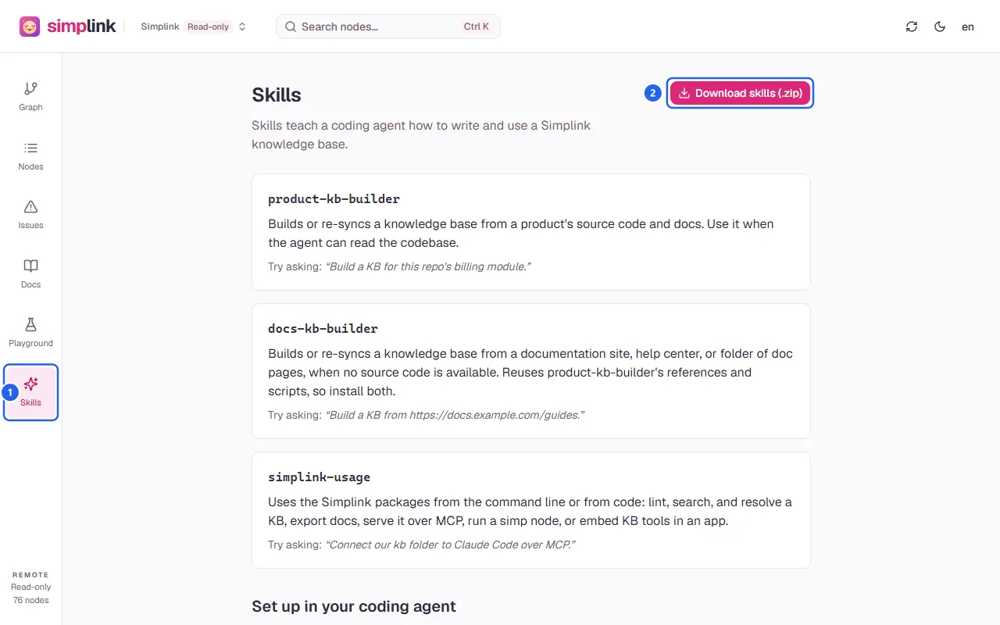

## Steps

1. Open **Skills** in the sidebar. The page lists the three skills: `product-kb-builder` builds or re-syncs a KB from source code and docs, `docs-kb-builder` builds one from a documentation site or folder of doc pages, and `simplink-usage` runs and embeds the Simplink packages.

   

2. Select **Download skills (.zip)** (2) to save `simplink-skills.zip`, which holds one folder per skill.
3. In the project, install the CLI that the skills run: `npm install -D @sontx/simplink-core`.
4. Unzip the bundle into the agent's skills folder and keep the folders side by side. For Claude Code use `.claude/skills` for one project or `~/.claude/skills` for every project; for Codex use `.agents/skills` or `~/.codex/skills`. Other agents use their Agent Skills folder, or are told to read `SKILL.md` before starting.
5. Restart the agent, then ask in plain words, for example `Build a KB for this repo's billing module.` or `Connect our kb folder to Claude Code over MCP.` The agent loads the matching skill.
6. Open the resulting `kb` folder in the UI to review the graph and fix issues.

## Failure handling

- `docs-kb-builder` reuses the references and scripts of `product-kb-builder`; install both, or it cannot run.
- The bundle is built into the UI when it is built, so it matches that UI's version, not later skill changes.
