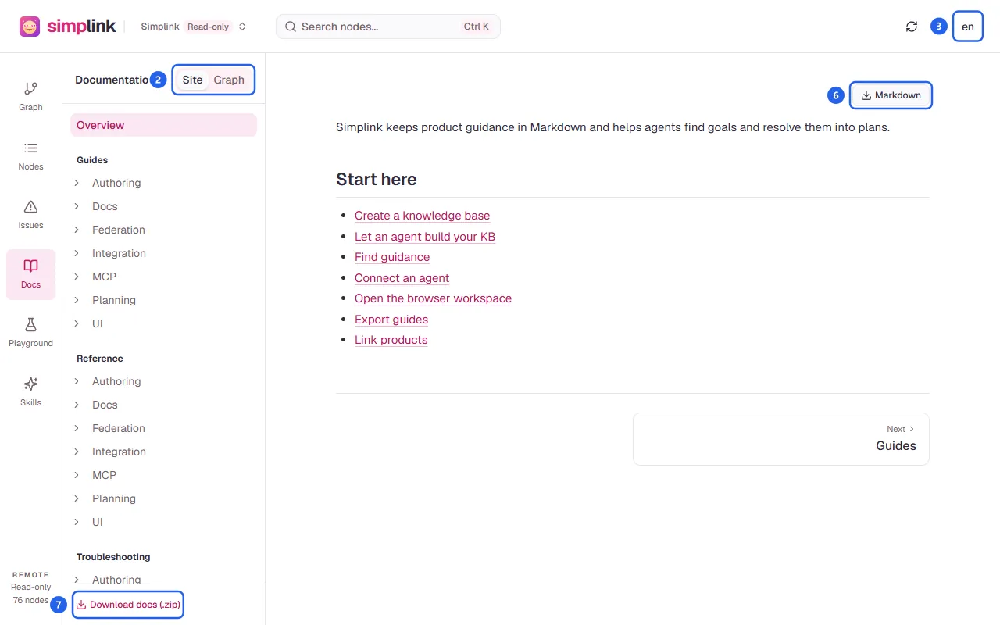

## Steps

1. Open **Docs** in the sidebar.
2. Choose **Site** or **Graph** under **Docs layout**.

   

3. Choose the language in the header's language menu (3). Generated headings and steps in the preview, the downloads, and agent plans follow it. Node content is shown as written.
4. Browse the pages with the navigation, the breadcrumb, **Previous** and **Next**, and **On this page**.
5. To see where a node is published, open the node and select its **Docs** tab, then **Open docs**.
6. Select **Markdown** (6) to download the current page.
7. Select **Download docs (.zip)** (7) to download all generated Markdown pages for the selected layout, preserving folders and relative links. Images the pages link are included at their KB paths; missing or unreadable ones are skipped. This works in folder, memory, and remote workspaces.
8. Review the pages before publishing. Like the preview, the ZIP can include pages from a KB with lint errors; `simp-docs` requires a valid KB.

## Failure handling

- The preview works even when the KB has lint errors and shows `{count} lint errors · Preview is available, but simp-docs would refuse to export.`
- Invalid or duplicate `docs.path` values stop the **Site** preview with the reason, such as `Duplicate docs path: <path>`. Fix the node's `docs` frontmatter in **Source**; the **Graph** layout still works meanwhile.
